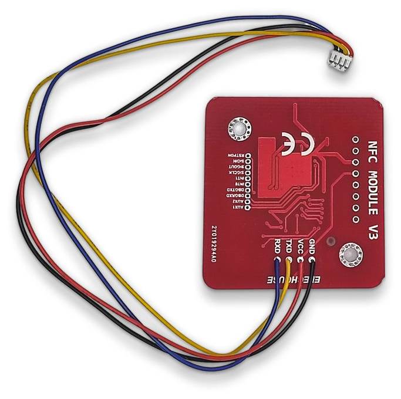
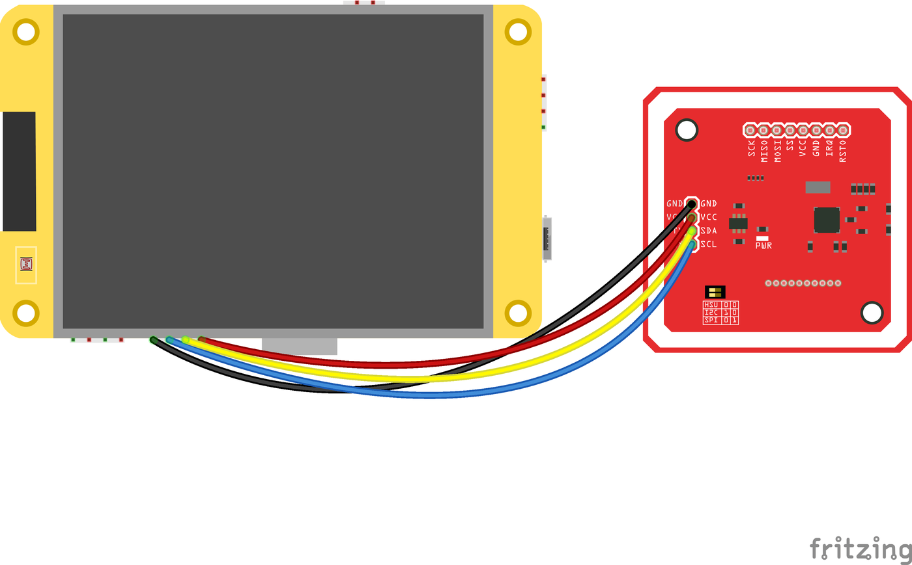
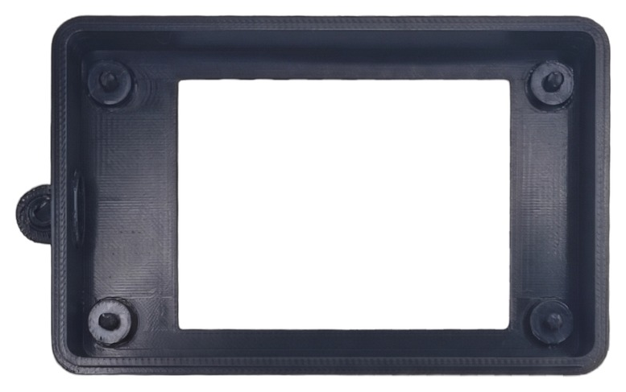
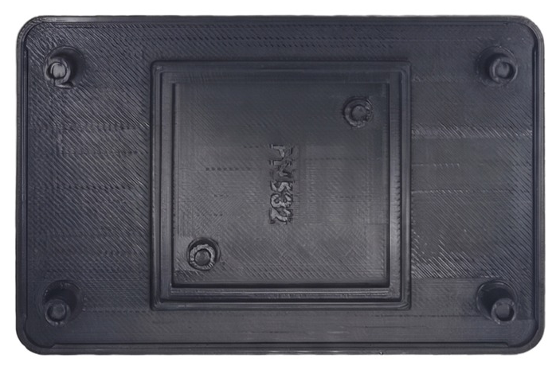
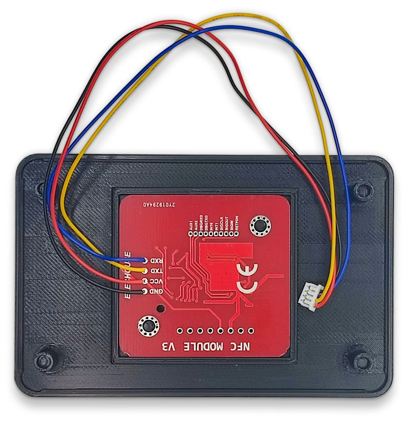
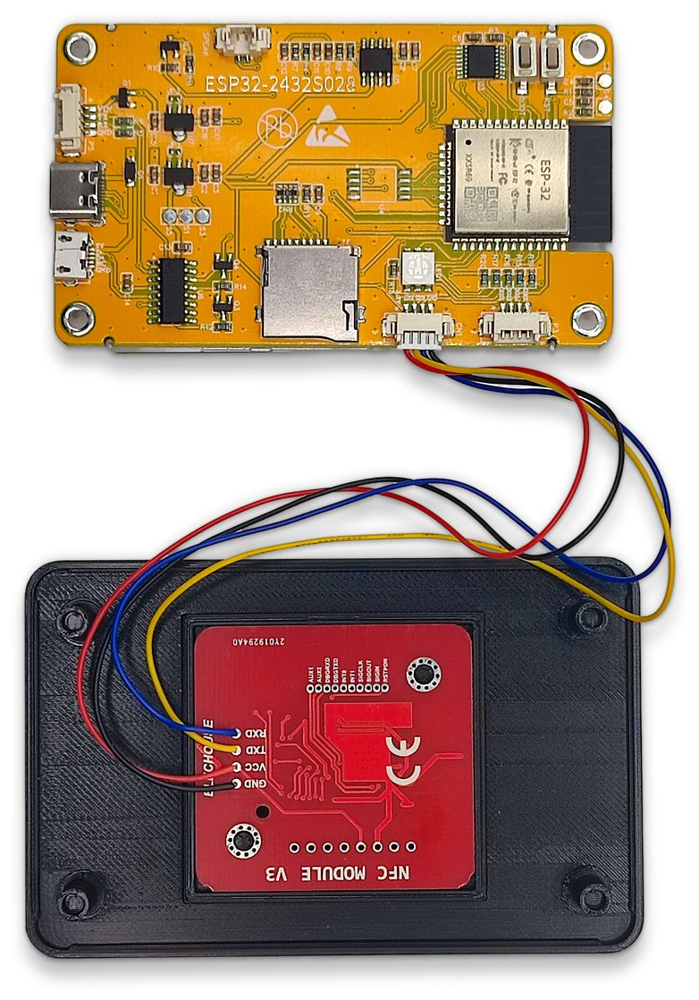
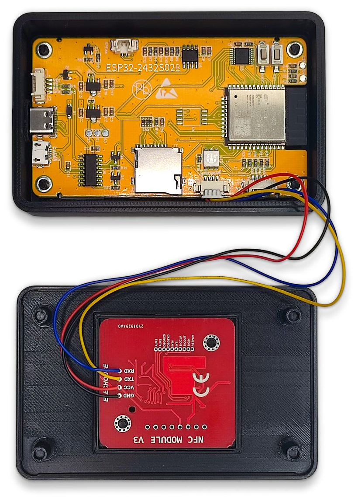
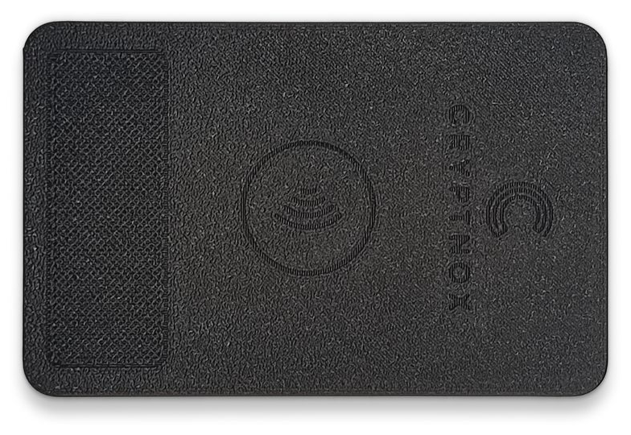
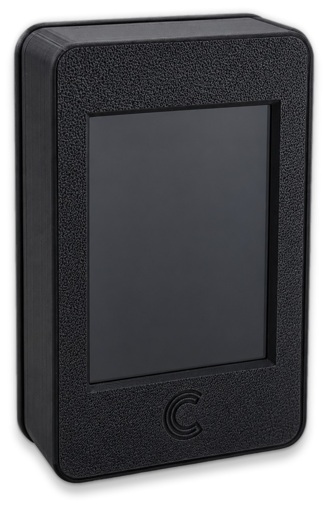

:description: Build a Cryptnox POS terminal: wiring the PN532 NFC module to the ESP32 Cheap Yellow Display and closing them into the printed snap-fit enclosure.

=======================
Assembling the terminal
=======================

A 2.8-inch ESP32 display board and an NFC reader, into a two-part printed
snap-fit shell. Seven steps, one soldering job, no fasteners.

What you need
-------------

.. list-table::
   :header-rows: 1
   :widths: 28 72

   * - Part
     - Notes
   * - ESP32-2432S028
     - The 2.8-inch “CYD” board. The marking is printed on the back, next to the ESP32 module.
   * - PN532 NFC Module V3
     - The square red board. Any V3 clone works; it must have the mode DIP switches.
   * - 4-wire harness
     - 1.25 mm JST plug at one end, bare wires at the other. Black, red, yellow and blue, to match the table below.
   * - Printed shells
     - case_front.stl and case_back.stl, or case_plate.3mf to print both at once. PLA or PETG. They snap together, so print them dimensionally accurate — an over-extruded lip will not clip.

Assembly
--------

Wire the NFC module
~~~~~~~~~~~~~~~~~~~

* Set the mode switches to I²C first. They are awkward to reach once the wires are on.
* Solder the four wires to the pad header, following the wiring table.
* Leave about 10 cm of slack — the module ends up in the other half of the shell.

.. list-table::
   :header-rows: 1
   :widths: 20 45 35

   * - Wire
     - PN532 pad
     - Goes to
   * - Black
     - GND
     - GND
   * - Red
     - VCC
     - 3V3
   * - Yellow
     - SDA — the TXD pad
     - GPIO 27
   * - Blue
     - SCL — the RXD pad
     - GPIO 22

.. important::

   **Set the DIP switches to I²C** before soldering — the two switches go to 1 0, and the silkscreen beside them lists all three modes. The pads keep their serial names (RXD, TXD) whatever the mode is, which is why the table names both.

   The four wires between the CYD's CN1 header and the PN532, by colour.

Lay out the shells
~~~~~~~~~~~~~~~~~~

* Front shell, top: the screen window and the four posts the board sits on. The small
  round nub on the left edge is a leftover printing support, not a button — break it off.
* Back shell, bottom: the raised square pocket, marked PN532.

*Supports are not needed on either part if they print window-down and pocket-up.*

Seat the NFC module
~~~~~~~~~~~~~~~~~~~

* Drop the PN532 into the pocket with the component side facing **up**, towards you.
* That puts the antenna coil against the outside of the lid, where the contactless symbol is.
* Route the four wires out over the lip towards the other half.

*Turn the module over and the antenna reads through the board instead of the lid — cards then have to be held on the wrong face, if they read at all.*

Plug the harness in — before the board goes anywhere
~~~~~~~~~~~~~~~~~~~~~~~~~~~~~~~~~~~~~~~~~~~~~~~~~~~~

* With the board still **outside** the shell, plug the JST end into CN1, the left of the two 4-pin connectors, next to the SD slot.
* Red goes to the end nearest the SD slot, then yellow, blue, black.
* Only then move on to the next step.

.. list-table::
   :header-rows: 1
   :widths: 20 45 35

   * - CN1
     - Wire
     - Signal
   * - nearest the SD slot
     - Red
     - 3V3
   * - 
     - Yellow
     - GPIO 27 · SDA
   * - 
     - Blue
     - GPIO 22 · SCL
   * - outermost
     - Black
     - GND

*This is the one ordering that matters in the whole build. Once the board is down in the shell, the connector sits against the wall and there is no room to get a plug onto it — you would have to lift the board out again.*

Lower the board into the front shell
~~~~~~~~~~~~~~~~~~~~~~~~~~~~~~~~~~~~

* Screen down, USB-C lined up with the cutout in the side wall, cable already attached.
* The four PCB holes should sit over the posts without forcing. If one fights you, check the print for stringing on that post.
* Lay the slack along the inside wall, clear of the posts, so nothing is pinched when the shells meet.
* Power it up before closing. The splash should reach *Starting NFC reader*.

*This is the last point where a wiring mistake costs seconds rather than a full disassembly.*

Snap it shut
~~~~~~~~~~~~

* Line the halves up square, then press around the perimeter until the clips engage all the way round. You should hear them go.
* To open it again, start at the seam on one of the long sides and work a thin blade round — never lever from a corner.
* The contactless symbol on the lid marks where a card is read.

Done
~~~~

* The screen sits flush in its window and the shell closes with no gap along the seam.
* USB-C on the side is the only opening — it carries both power and firmware updates.

