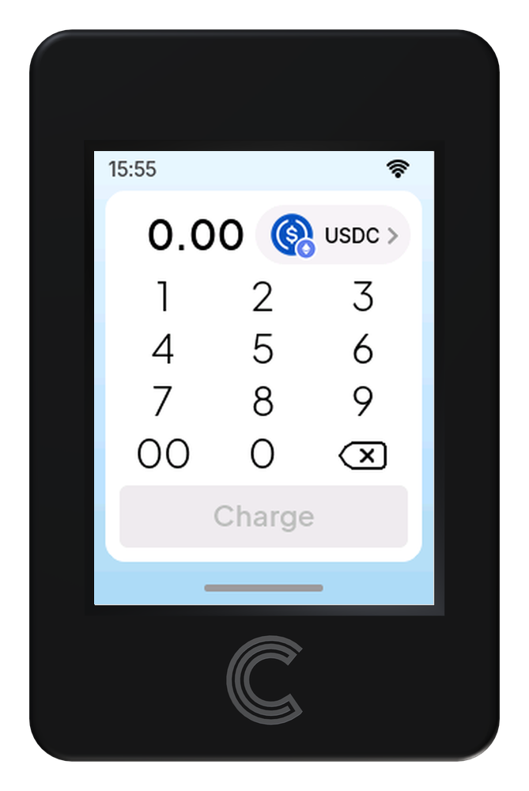
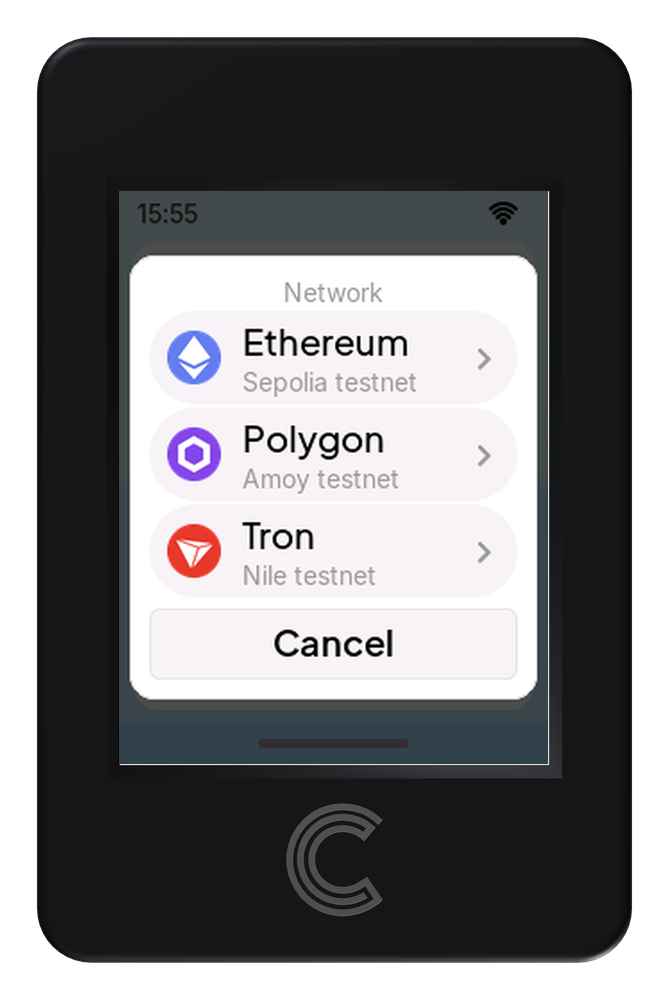
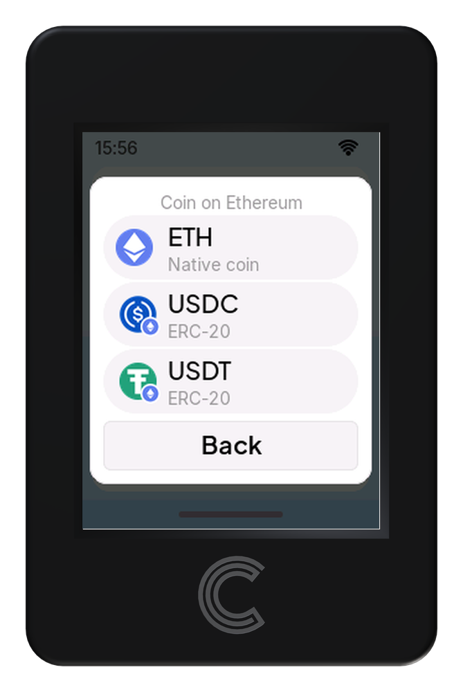
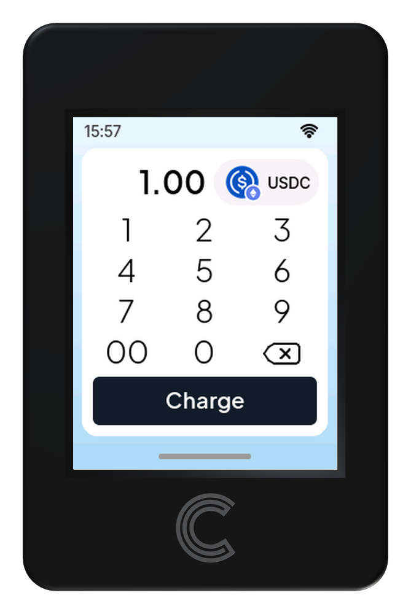
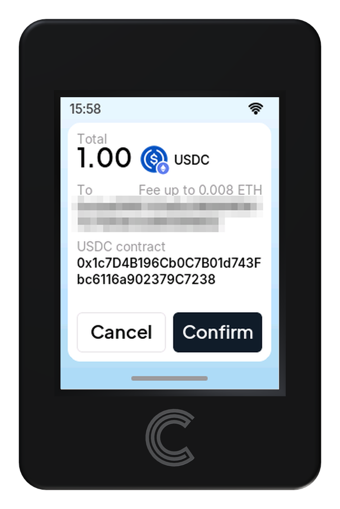
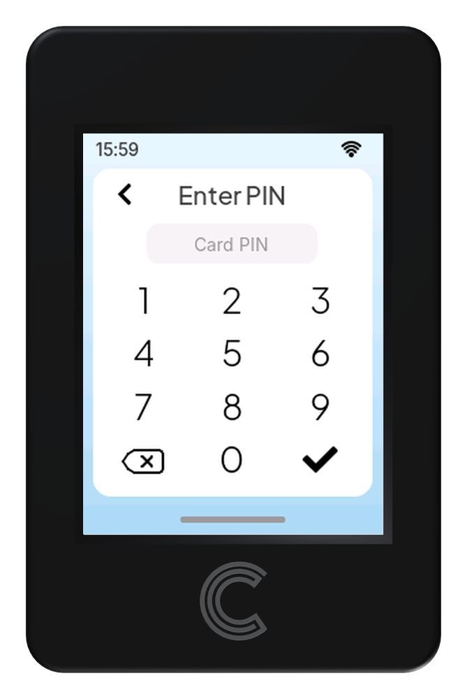
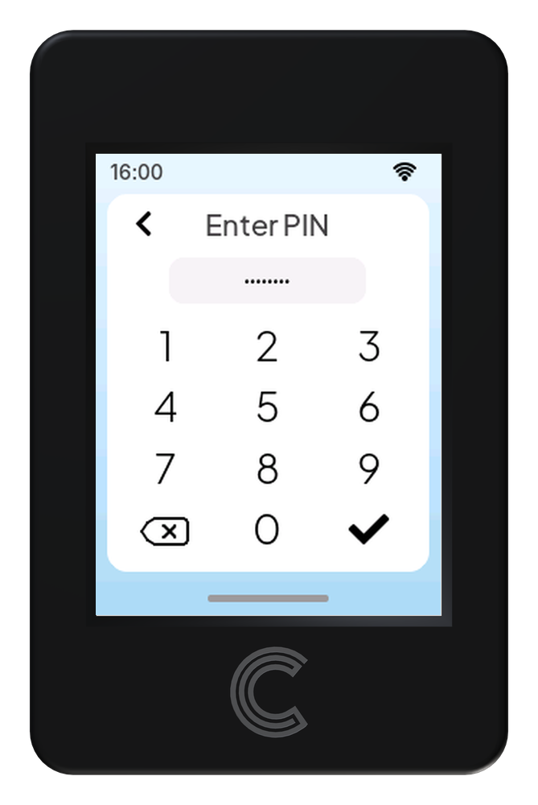
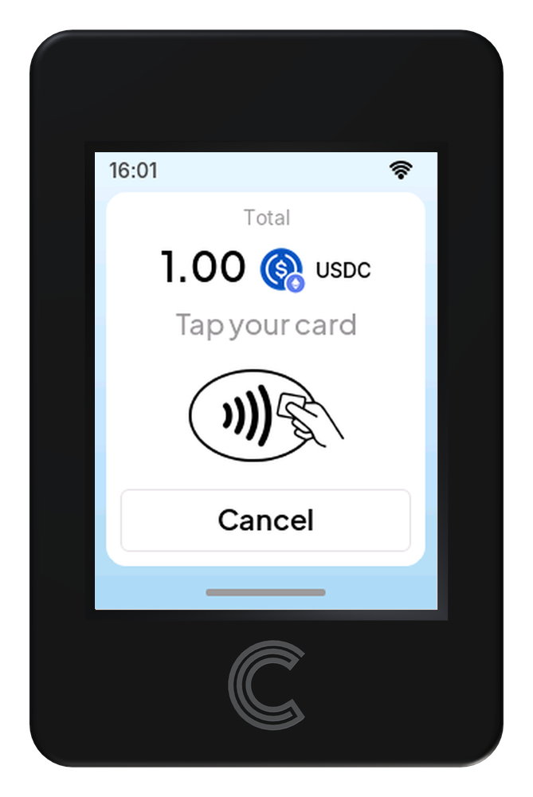
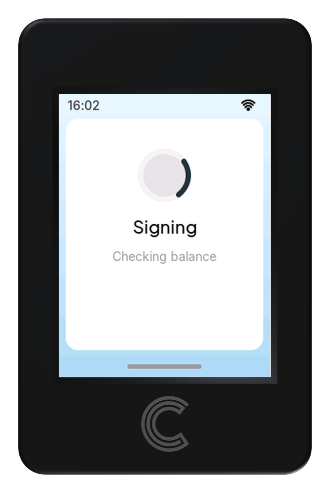
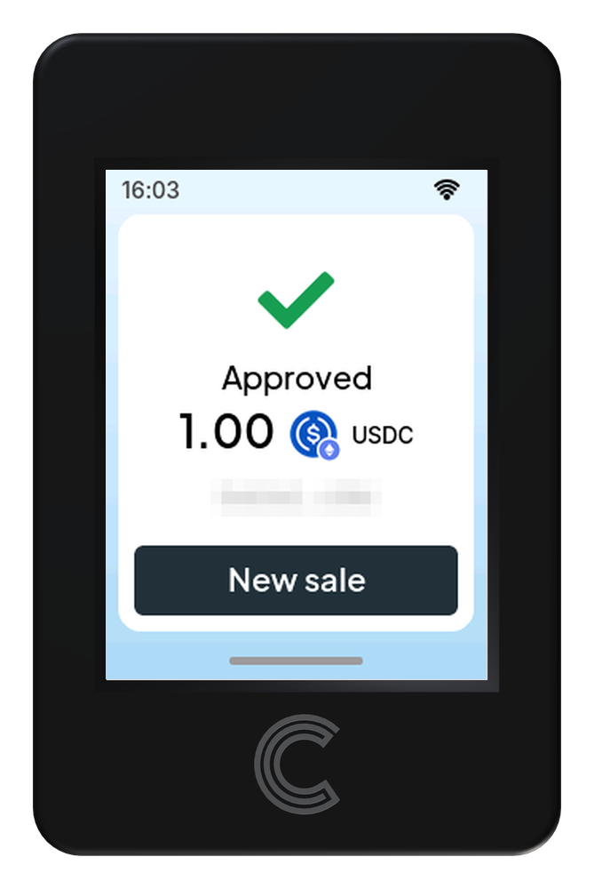

:description: A sale on a Cryptnox POS terminal, screen by screen: choosing the coin, the amount, the card PIN, tapping the card and the Approved screen.

=====================
Taking a USDC payment
=====================

Everything happens on the terminal, but two people use it: the merchant
sets up the charge, the customer approves it and pays with the card.

Before you start
----------------

The terminal must already be set up and connected to Wi-Fi. The customer’s Cryptnox card needs enough USDC on Ethereum, plus a little ETH to pay the network fee.

Choose the coin
---------------

The amount screen opens on the coin used last time. Change it if needed.

   Tap the coin button next to the amount.

   Pick the network: **Ethereum**.

   Pick the coin: **USDC** (ERC-20).

Enter the amount
----------------

   Type the amount, for example **1.00**. The **00** key adds two zeros at once. Tap **Charge**.

Review the payment
------------------

   The terminal shows the total, the recipient (the merchant’s payout address), the maximum network fee in ETH, and the USDC contract. Tap **Confirm**, or **Cancel** to stop.

.. note::

   The recipient must be the merchant’s own payout address. If it isn’t, tap **Cancel**.

Enter the card PIN
------------------

   The terminal asks for the PIN of the Cryptnox Hardware Wallet that will pay.

   Type the PIN and tap **✓**. The back arrow returns to the previous screen.

Tap the card
------------

   With the total still on screen, hold the Cryptnox card against the reader. Tap **Cancel** to stop the payment.

   The terminal checks the card’s balance and the card signs the payment. Keep the card on the reader and wait for the result.

Payment approved
----------------

   The terminal shows **Approved** with the amount, coin and a shortened transaction hash. Tap **New sale** to take the next payment.

.. note::

   Addresses, fees and amounts shown will differ on your terminal.
