:description: The Cryptnox POS control panel and the browser settings page: display, Wi-Fi, transaction details, firmware, payout addresses and gas fees.

========================
Configuring the terminal
========================

How to open the control panel, what each of its four tabs does, and how to
finish the setup from your phone. Allow about ten minutes, and keep the
admin code to hand.

Open the control panel
----------------------

Start from the sale screen, the one with the keypad and the **Charge** button.

Find the small grey bar at the very bottom edge of the screen. Put your finger on it and **slide it upwards**, towards the keypad.

The admin code screen slides up from the bottom.

.. note::

   The swipe has to start on the bar itself. A swipe that starts on the keypad does nothing.

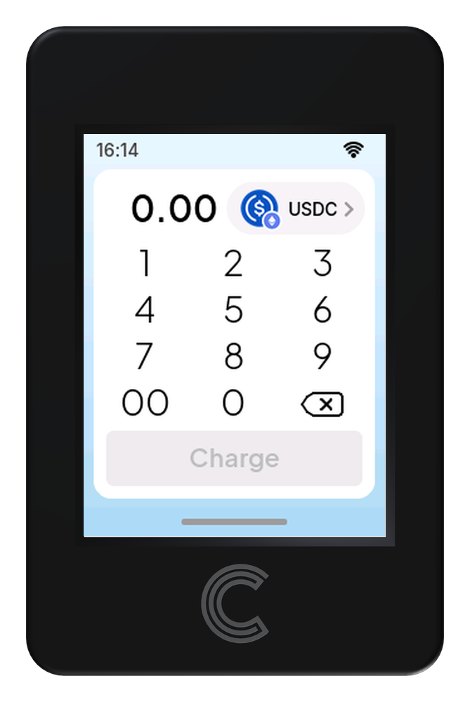

   Slide the bottom bar up

Enter the admin code
--------------------

* Type the admin code on the keypad. Each digit appears as a dot.
* Tap the **eye** icon if you want to check what you typed.
* Use **⌫** to delete the last digit.
* Tap **✓** to confirm.

The **‹** arrow next to *Control panel* takes you back to the sale screen without opening anything.

.. note::

   The admin code is the one created when the terminal was first set up. It is only ever typed on the terminal itself, never on a phone or computer.

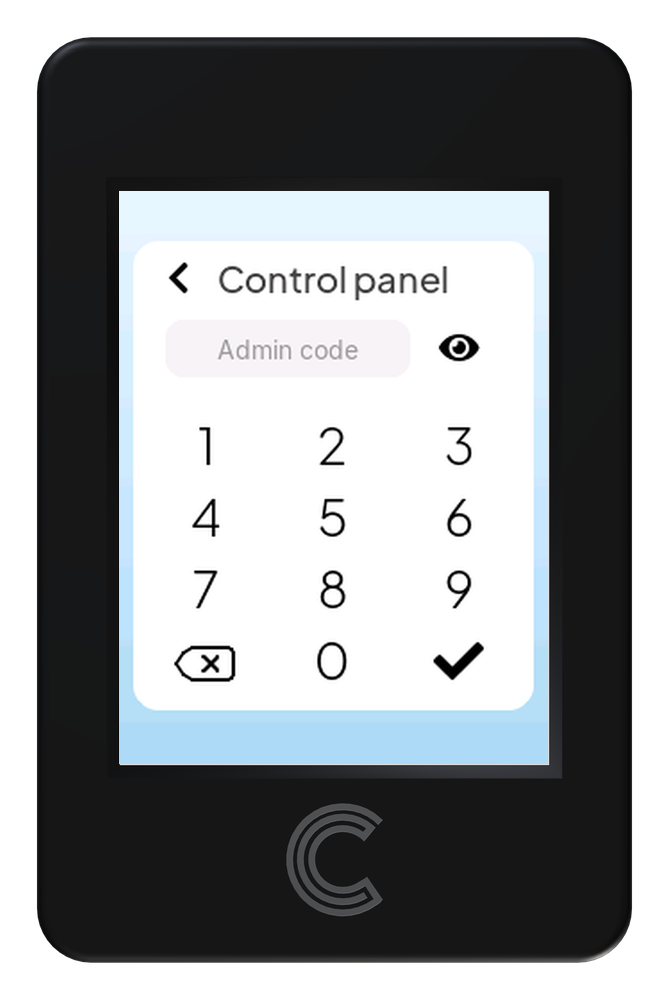

   Empty field

   Code entered, tap ✓

The four tabs: Screen, Wi‑Fi, Tx, About
---------------------------------------

The control panel has four tabs along the top. Tap a tab name to switch. **Close** returns to the sale screen.

Screen — Display settings
~~~~~~~~~~~~~~~~~~~~~~~~~

This is the only tab you configure entirely on the terminal.

.. list-table::
   :header-rows: 1
   :widths: 26 74

   * - Setting
     - What it does
   * - Brightness
     - Drag the slider left or right. The percentage on the right updates as you go.
   * - Touch
     - Tap *Calibrate the panel* if taps land in the wrong place, then follow the targets on screen.

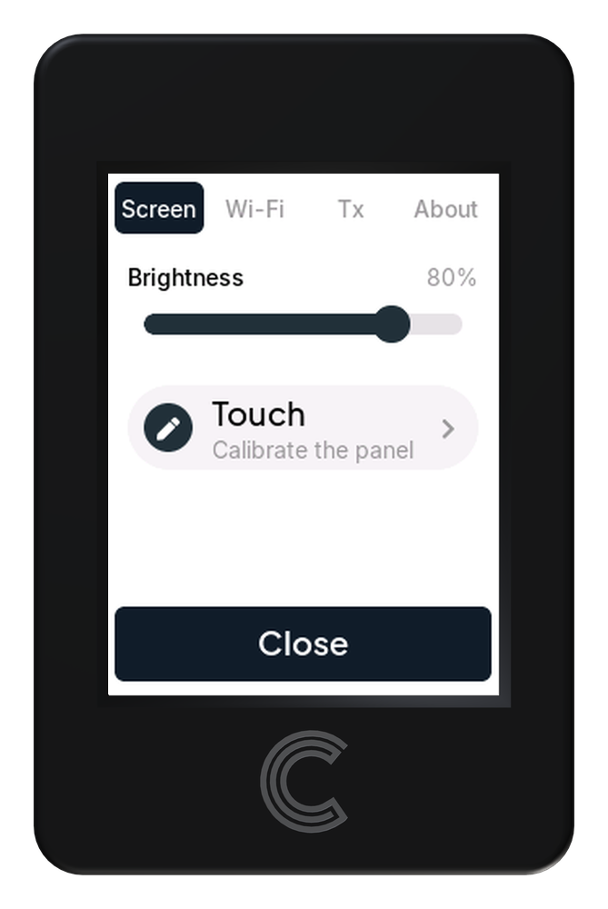

Wi‑Fi — Network connection
~~~~~~~~~~~~~~~~~~~~~~~~~~

.. list-table::
   :header-rows: 1
   :widths: 26 74

   * - Setting
     - What it does
   * - Network
     - The Wi‑Fi network the terminal is connected to now.
   * - Configure
     - Opens the phone setup page, where you pick another network and type its password. See step 4.

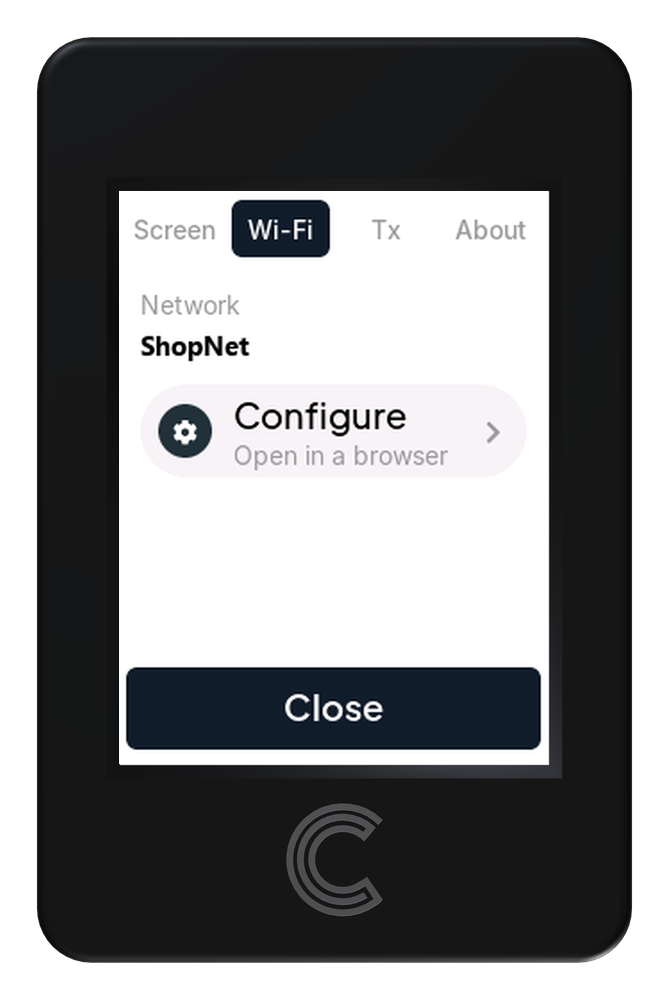

Tx — Transaction details
~~~~~~~~~~~~~~~~~~~~~~~~

What the terminal charges in and where the money goes. This tab is read‑only and scrolls.

.. list-table::
   :header-rows: 1
   :widths: 26 74

   * - Setting
     - What it does
   * - Asset
     - Tap the top row (here *USDC · Ethereum Sepolia*) to view another asset's details.
   * - Contract
     - The token contract the terminal uses for that asset.
   * - Send to
     - Your payout address. Every sale is paid here.
   * - Max fee / Priority fee
     - The gas limits for Ethereum and Polygon, in Gwei.
   * - Configure
     - At the bottom of the list. Opens the phone setup page to change any of the above.

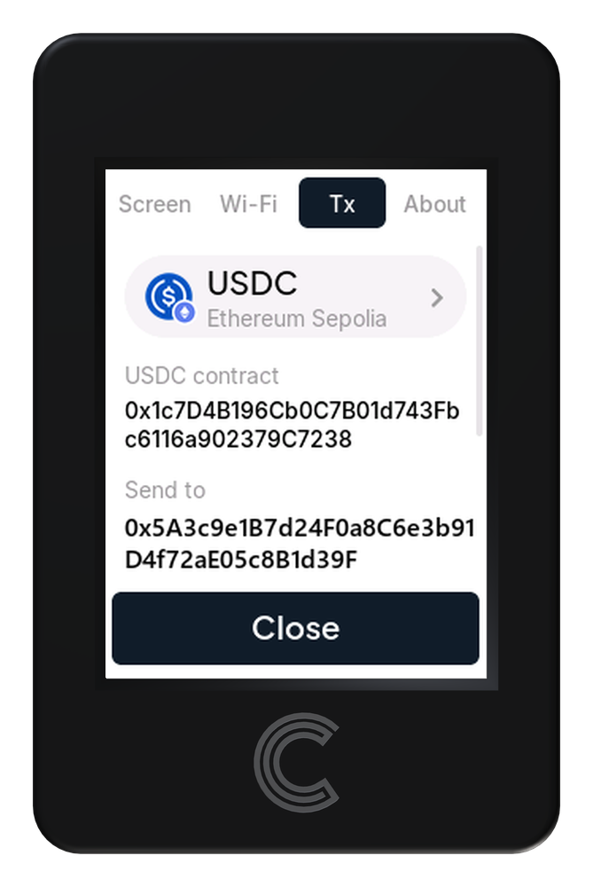

   Top

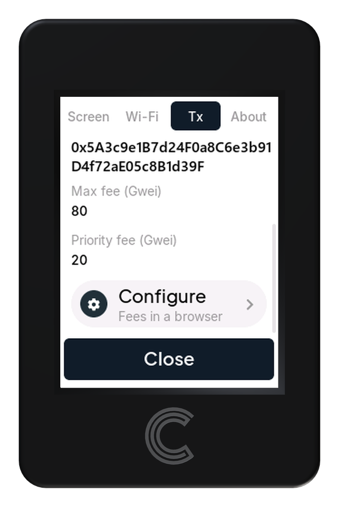

   Scrolled down

About — Version, update and reset
~~~~~~~~~~~~~~~~~~~~~~~~~~~~~~~~~

.. list-table::
   :header-rows: 1
   :widths: 26 74

   * - Setting
     - What it does
   * - Version
     - The firmware the terminal runs, for example ``v1.0.0-5-g06666d1``.
   * - Update
     - Opens the phone setup page to install new firmware.
   * - Reset
     - Erases everything the terminal has stored and restarts into first-time
       setup. The terminal asks you to confirm first.

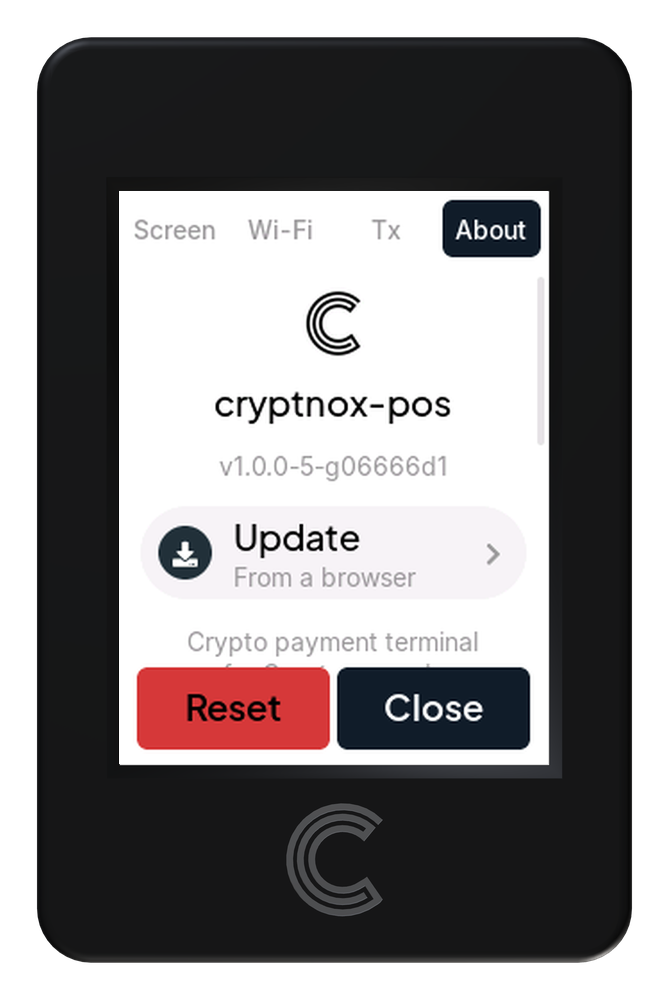

.. warning::

   **Reset leaves nothing behind.** It is not limited to Wi-Fi, brightness and
   gas fees: the admin code, the payout addresses, the token contracts and the
   production-or-test choice go with them. The terminal comes back up as it
   left the factory and has to be set up from scratch, card included.

.. important::

   **Three buttons, one destination** The buttons in **Wi‑Fi**, **Tx** and **About** have different labels but do exactly the same thing: they start the terminal's own Wi‑Fi so you can finish the job on your phone. Whichever one you tap, you land on the same page, with every setting on it.

Connect your phone to the terminal
----------------------------------

After you tap one of the three buttons, the terminal shows a QR code and the name and password of its own Wi‑Fi network, named ``Cryptnox-XXXX``.

* Open your phone's camera and point it at the QR code. Accept the offer to join the network. No camera? Join ``Cryptnox-XXXX`` in your phone's Wi‑Fi settings and type the password shown on the terminal.
* The phone opens a sign‑in window titled *Connect to Cryptnox‑XXXX* (address ``192.168.4.1``). If it doesn't, open ``http://192.168.4.1/`` in a browser.
* The page asks you to authorize this browser. **Look at the terminal**: it asks for the admin code again and shows a four‑digit browser number.
* Check that the number on the terminal matches the one on your phone, then enter the admin code on the terminal.

.. warning::

   **While the page is open,** the terminal leaves the shop's Wi‑Fi and cannot take payments. The page closes on its own after 15 minutes.

.. note::

   If the numbers don't match, another device is trying to connect. Don't enter the code; tap Done and start again.

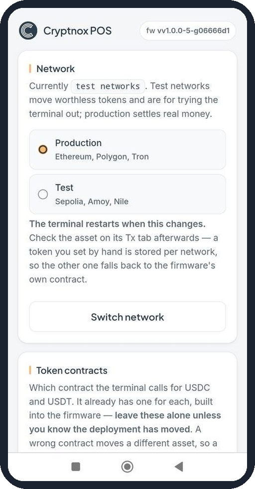

   The setup page on your phone

Configure in the browser
------------------------

The page is one long scroll of sections. Change only what you need; each section has its own save button. Anything that decides where money goes must then be accepted on the terminal's screen.

Network
~~~~~~~

Choose between **Production** (Ethereum, Polygon, Tron, real money) and **Test** (Sepolia, Amoy, Nile, worthless test tokens for trying the terminal out). Select one and tap **Switch network**.

.. note::

   The terminal restarts when the network changes. Check the asset on the Tx tab afterwards.

.. figure:: _static/guides/settings/10.png
   :alt: Network section with Production and Test options and a Switch network button
   :width: 260px

Token contracts
~~~~~~~~~~~~~~~

The contracts the terminal calls for USDC and USDT, one for ERC‑20 (Ethereum) and one for TRC‑20 (Tron). The firmware already has the right ones built in.

.. warning::

   **Leave these alone** unless you know the token's deployment has moved. A wrong contract moves a different asset. A new contract must be accepted on the terminal screen.

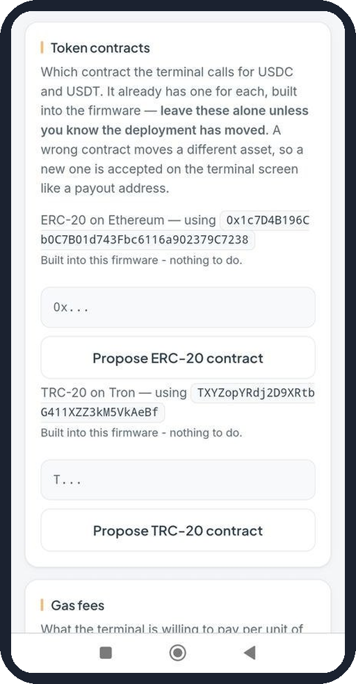

Gas fees
~~~~~~~~

The most the terminal will pay per unit of gas on Ethereum and Polygon, in Gwei.

Tap **Save gas fees**. The new values apply from the next sale.

.. list-table::
   :header-rows: 1
   :widths: 26 74

   * - Setting
     - What it does
   * - Max fee
     - Upper limit per unit of gas.
   * - Priority fee
     - The tip to validators. Capped by the max fee.

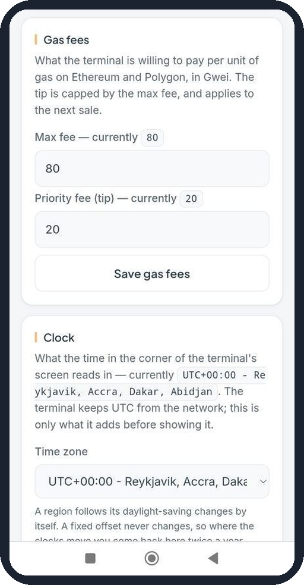

Clock
~~~~~

Sets the time zone for the clock in the corner of the terminal's screen. Pick your region in the **Time zone** list and tap **Save clock**.

.. note::

   Entries marked *EU DST* follow daylight‑saving changes automatically. A fixed offset never changes, so you would have to come back twice a year.

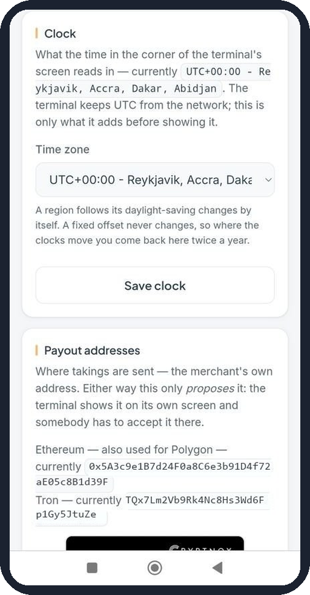

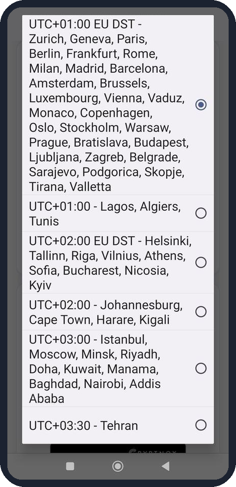

Payout addresses
~~~~~~~~~~~~~~~~

Where takings are sent. There are two ways to set them:

* **Read from a Cryptnox card.** Tap the button. The terminal asks for the card's
  PIN first, on its own keypad; only then do you hold the *merchant's* card
  against the reader. The card's own addresses become the payout addresses.
* **Type an address.** One Ethereum address (also used for Polygon) and one Tron address, each with its own **Propose** button.

.. warning::

   **Either way, the phone only proposes the address.** The terminal shows it on its own screen, and you must tap Accept there. Check it character by character before you do.

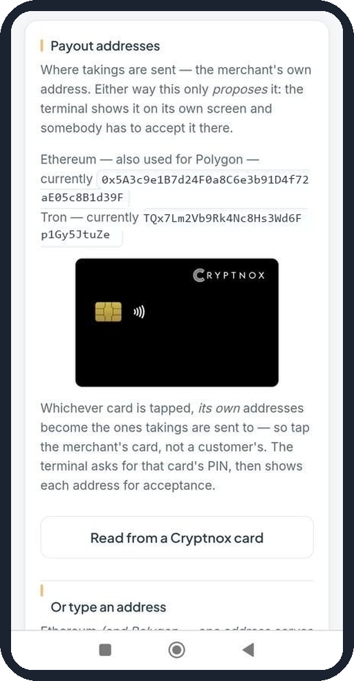

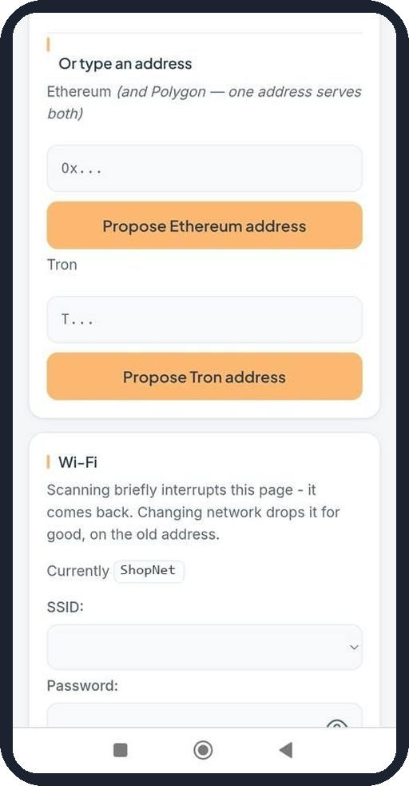

Wi‑Fi
~~~~~

Connects the terminal to the shop's network.

* Open the **SSID** list and choose your network. The number in brackets is signal strength: closer to zero is stronger.
* Type the network password.
* Tap **Join this network**.

.. note::

   Tap **Scan again** if your network is missing; the page drops for a moment and comes back. Once the terminal joins the new network, this page disconnects for good.

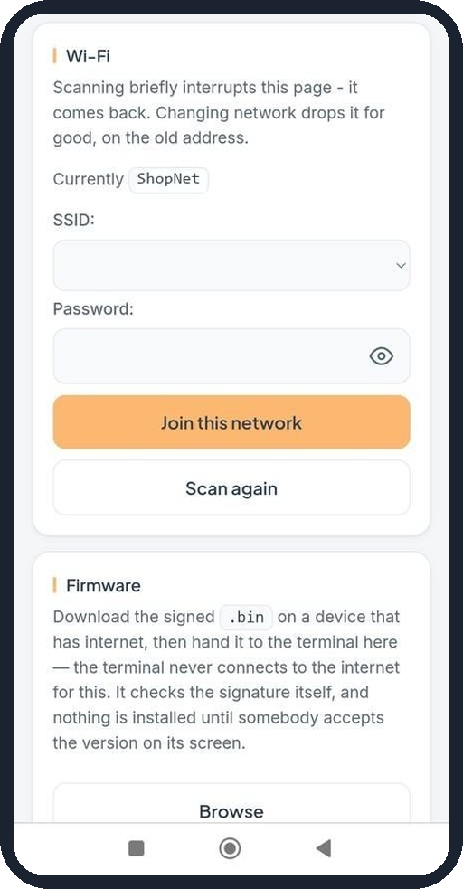

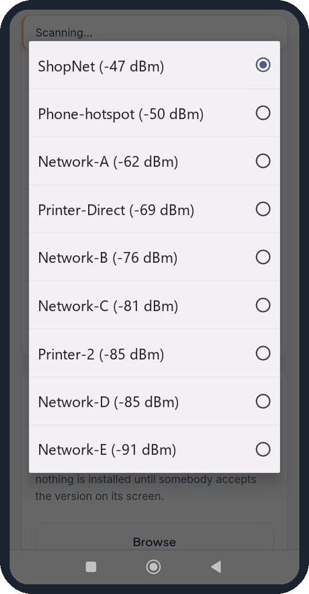

Firmware
~~~~~~~~

Installs a firmware update. The terminal never downloads it itself.

* On a device with internet, download the signed ``.bin`` file.
* Tap **Browse** and choose the file.
* The terminal checks the signature, then shows the new version. Accept it on the terminal to install.

.. warning::

   **Browse does nothing?** The phone's Wi‑Fi sign‑in window can't pick files, on Android or iOS. Stay on the ``Cryptnox-XXXX`` network, open ``http://192.168.4.1/`` in your normal browser and use the Firmware section there.

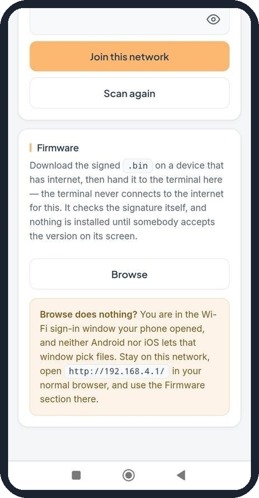

Close the session
-----------------

When you're finished, tap **Done** on the terminal. Its own Wi‑Fi switches off, it reconnects to the shop's network, and the page on your phone stops working.

Tap **Close** to leave the control panel and return to the sale screen. Before taking real payments, open the **Tx** tab once more and check the payout address.

.. note::

   If you forget, the session ends on its own after 15 minutes.

.. note::

   Screens from Cryptnox POS firmware v1.0.0-5-g06666d1. Payout addresses and Wi‑Fi network names in the screenshots are placeholders.

