:description: First run of a Cryptnox POS terminal, screen by screen: the admin code, authorising the browser, the payout addresses and the venue Wi-Fi.

=======================
Setting up the terminal
=======================

Setup moves back and forth between the terminal and your phone. Each step
says which of the two you are on.

Before you start
----------------

You need the terminal, a phone, the merchant’s Cryptnox card with its PIN, and the password of the Wi-Fi network the terminal will use. Allow about ten minutes.

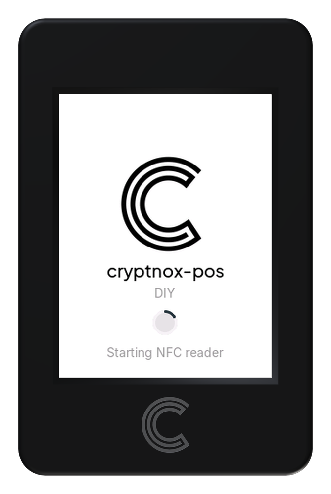

   Power the terminal on. It boots and starts its NFC reader.

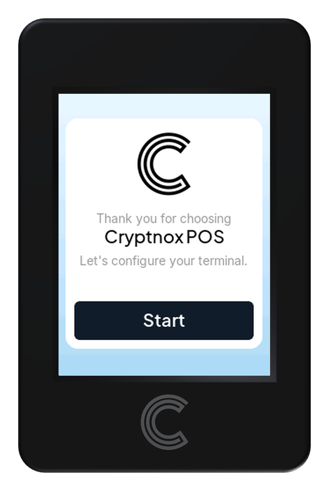

   On the welcome screen, tap Start.

Set the admin code
------------------

The admin code protects every change to the terminal. It is only ever typed on the terminal itself, never on a phone.

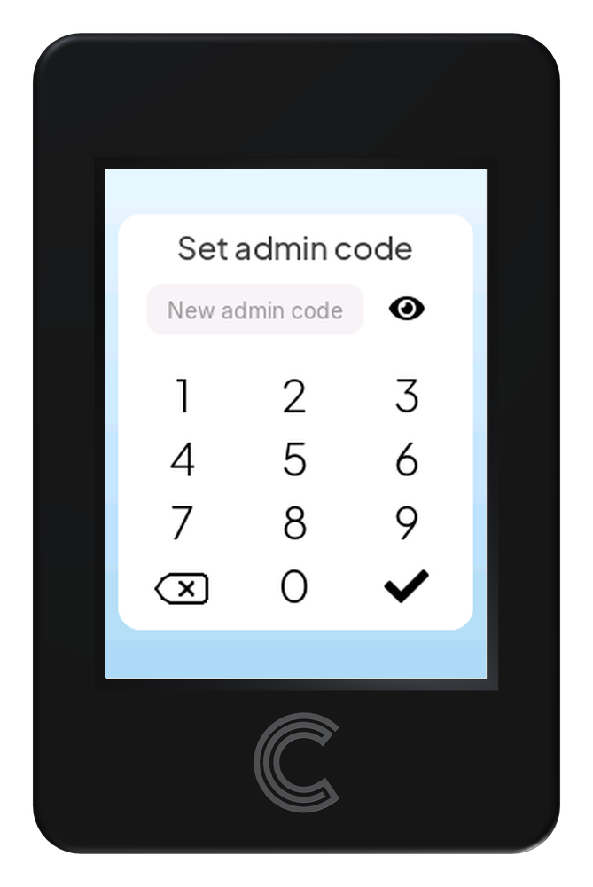

   Type a new admin code on the keypad. The eye icon shows or hides the digits. Tap ✓.

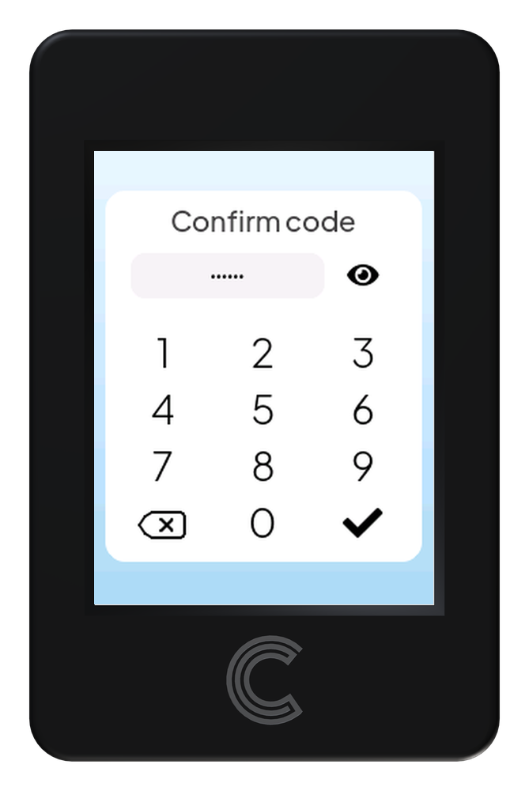

   Type the same code again to confirm, then tap ✓.

.. note::

   The code is 6 to 9 digits. Write it down and keep it safe: you will need it to authorize any phone that configures the terminal, and after three wrong attempts each one doubles the wait before the next, even across a restart, up to an hour.

Connect your phone
------------------

The terminal opens its own temporary Wi-Fi network, just for setup.

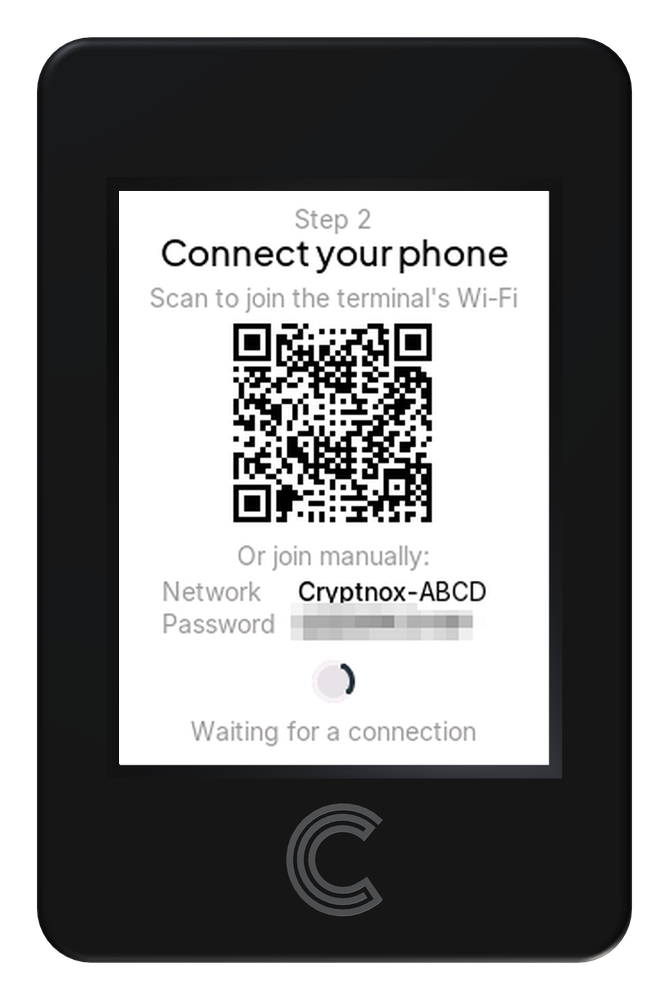

   Scan the QR code with your phone’s camera. Or join manually with the network name and password shown on the screen (each terminal has its own).

Authorize this browser
----------------------

The setup page has to be approved on the terminal, which proves you are standing in front of it.

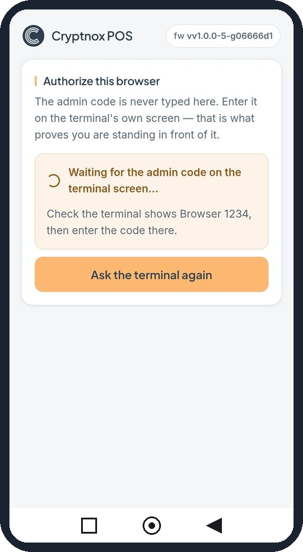

   The setup page waits and shows a browser number, for example Browser 1234.

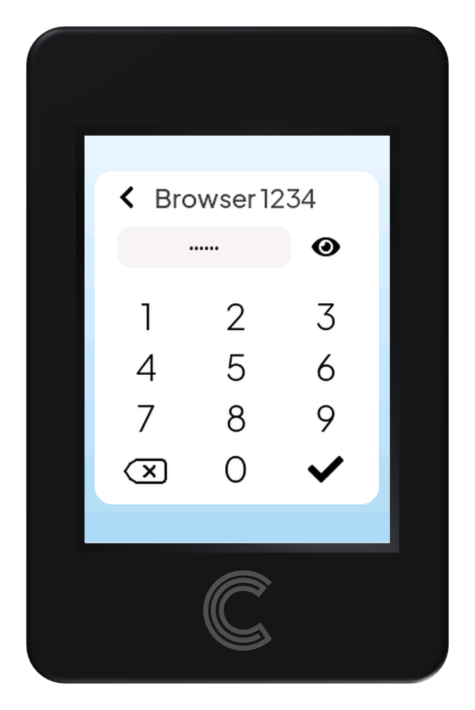

   The terminal shows the same browser number. Check that both numbers match, then enter the admin code and tap ✓.

.. note::

   If the terminal doesn’t show the request, tap **Ask the terminal again** on the phone. If the numbers don’t match, don’t enter the code: another device is trying to connect.

Set the payout addresses
------------------------

Payout addresses are where takings are sent: the merchant’s own addresses. The phone only proposes them; nothing changes until they are accepted on the terminal.

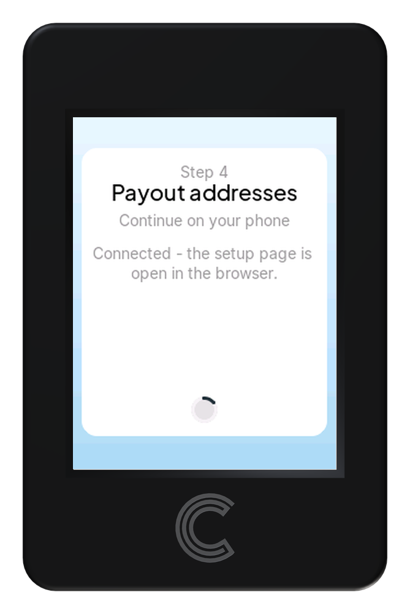

   The terminal tells you to continue on your phone.

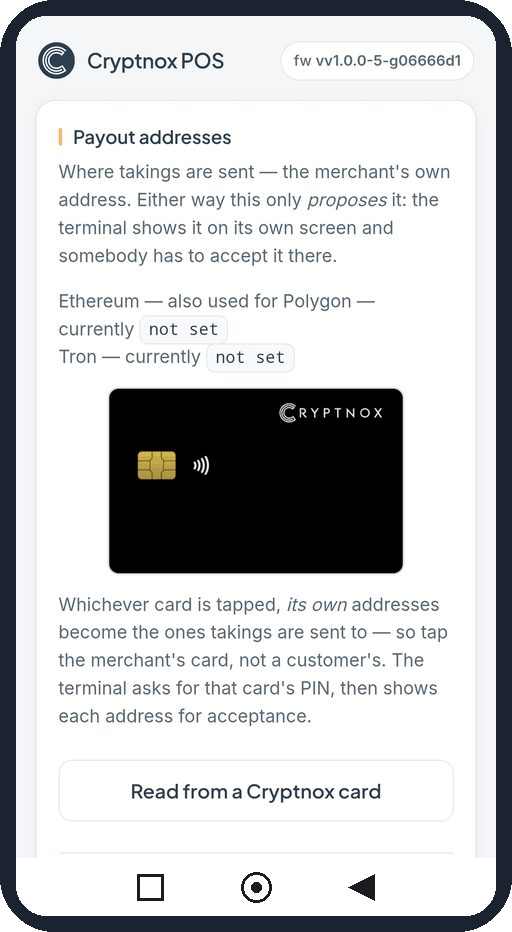

   The easiest way: tap Read from a Cryptnox card. Whichever card is tapped, its own addresses are used, so use the merchant’s card, never a customer’s.

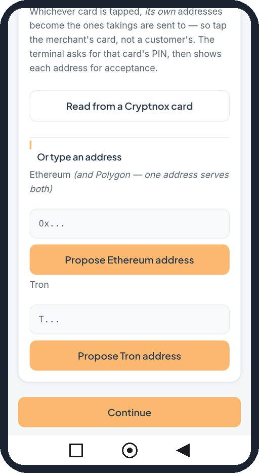

   Or type the addresses yourself: one Ethereum address (also used for Polygon) and/or one Tron address, then tap Propose for each. Tap Continue when you are done.

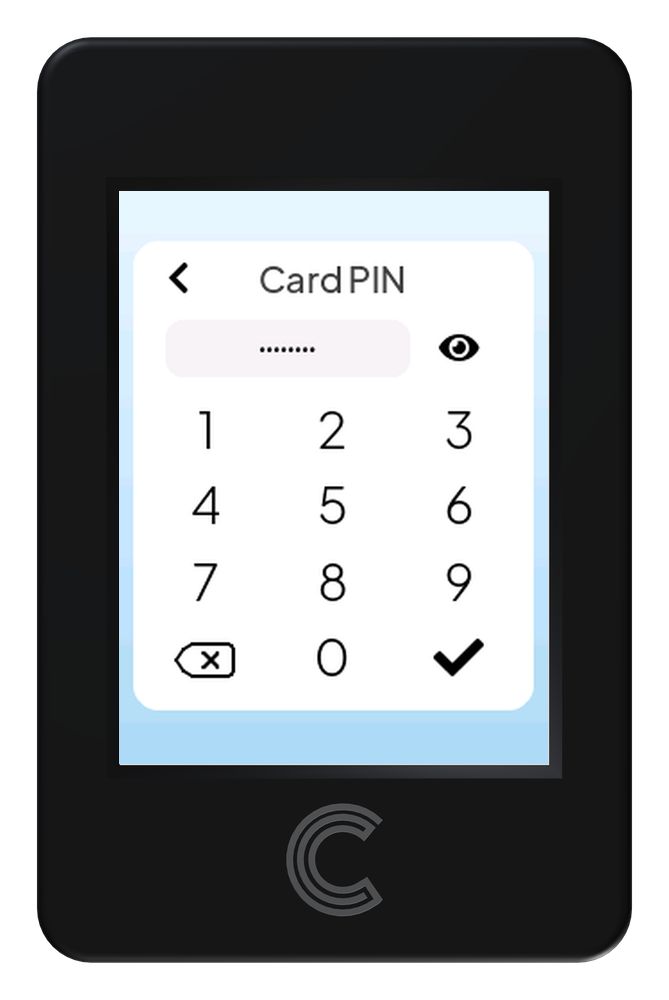

   If you chose to read a card, the terminal asks for that card’s PIN. Enter it and tap ✓.

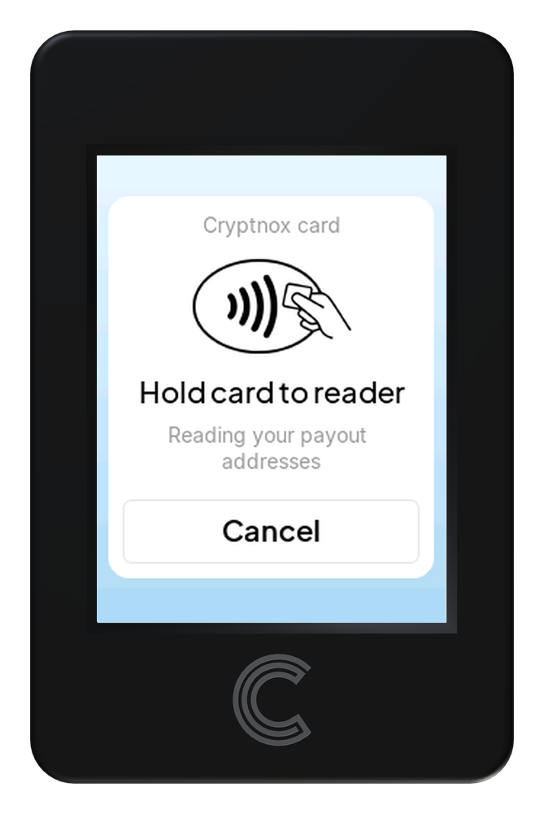

   Hold the merchant’s Cryptnox Hardware Wallet against the reader until the addresses are read.

Whichever way you chose, the terminal then shows each address on its own screen under **Set payout address?** Check it against your own records and tap **Accept**, or **Reject** to discard it. A card's Ethereum address comes first, then its Tron address.

When the addresses you want are accepted, tap **Continue** on the phone. The page refuses to continue until at least one payout address is set.

Connect to the shop's Wi-Fi
---------------------------

The terminal shows *Step 5 · Wi-Fi network*; carry on on the phone. A terminal that already has a saved network skips this step.

* Open the **SSID** list and pick the network. The number in brackets is signal strength: closer to zero is stronger. Tap **Scan again** if it is missing.
* Type the network password. Only WPA2 networks are supported.
* Tap **Join this network**.

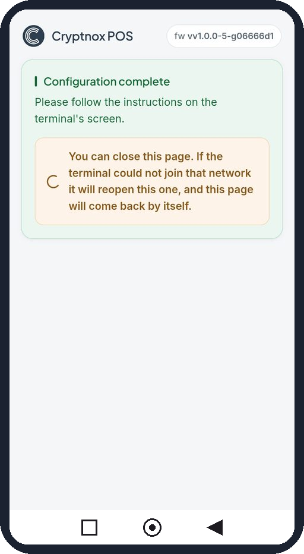

   The page shows Configuration complete. You can close it. If the terminal can’t join your network, it reopens the setup network and this page comes back by itself.

Finish on the terminal
----------------------

The terminal shows **All set**. Tap **Finish**: it restarts once to apply everything and opens on the sale screen.

.. note::

   Screens shown from firmware v1.0.0. Network names, browser numbers and addresses differ on every terminal.

