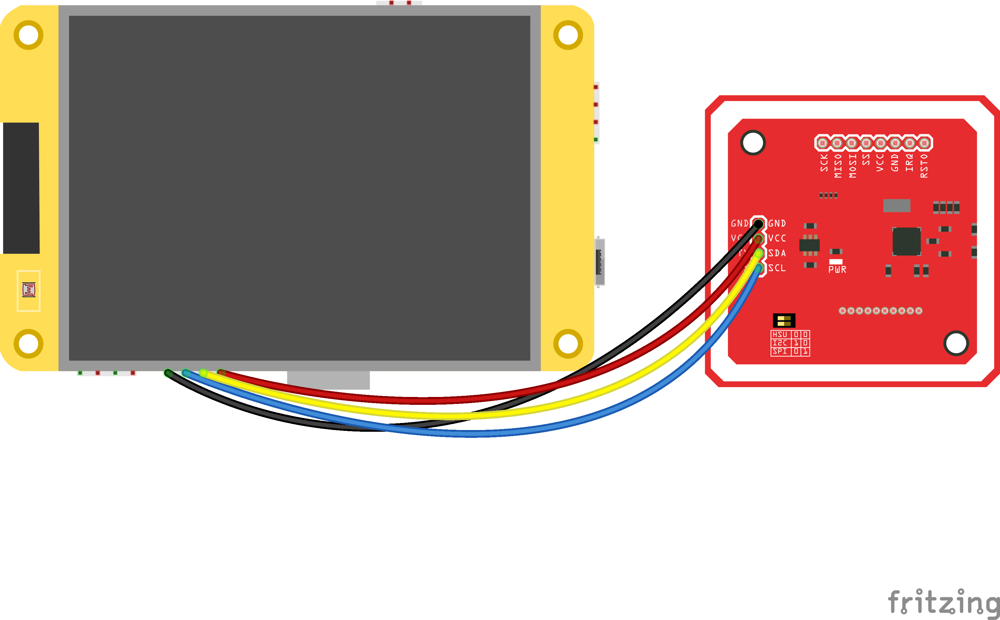

:description: The parts a Cryptnox POS terminal is built from, the I2C wiring between the ESP32 Cheap Yellow Display and the PN532 NFC module, and the printed snap-fit enclosure.

========
Hardware
========

What you need
=============

.. list-table::
   :header-rows: 1
   :widths: 28 72

   * - Part
     - Notes
   * - ESP32-2432S028 "Cheap Yellow Display"
     - ESP32-WROOM-32, 2.8" ILI9341 240×320 display used in portrait, XPT2046 resistive touch,
       4 MB flash. Sold under many names; the `CYD community repository
       <https://github.com/witnessmenow/ESP32-Cheap-Yellow-Display>`__ lists the variants.
   * - PN532 NFC module
     - The common red breakout board, used over **I²C**. Its two mode switches must be set to
       I²C.
   * - Cryptnox Hardware Wallet card
     - Firmware **v1.6.0 or later** (the `Dual Card Set
       <https://shop.cryptnox.com/product/hardware-wallet-smartcard-dual/>`__ ships v1.6.1).
       The card must be initialised with a seed; see :ref:`preparing-the-card`.
   * - Four jumper wires and a USB cable
     - Female-to-female Dupont wires between the CYD's CN1 header and the PN532; a data USB
       cable to flash and power the board.
   * - A computer
     - For the prebuilt firmware: any machine with Chrome or Edge, or Python and ``esptool``.
       To build from source: `ESP-IDF v5.5
       <https://docs.espressif.com/projects/esp-idf/en/v5.5/esp32/get-started/index.html>`__.

Wiring
======

The CYD exposes its free GPIOs on the **CN1** header. The firmware talks to the PN532 over I²C
on two of them.

.. list-table::
   :header-rows: 1
   :widths: 25 40 35

   * - PN532 pin
     - CYD pin (CN1)
     - Wire colour in the diagram
   * - GND
     - GND
     - black
   * - VCC
     - 3.3V
     - red
   * - SDA
     - GPIO 27
     - yellow
   * - SCL
     - GPIO 22
     - blue

   The four wires between the CYD's CN1 header and the PN532, by colour.

.. note::

   Set the PN532 mode switches to **I²C = ``1 0``** as printed on the board: switch 1 ON,
   switch 2 OFF (``0 1`` is SPI). The PN532 reads the switches only at its own power-up and
   its reset pin is not wired, so after changing them **unplug and replug the USB cable**; an
   ESP32 reset is not enough. Double-check the wiring before powering the board.

The display, touch panel and backlight are wired internally on the CYD and need nothing.

Enclosure
=========

The enclosure is a two-part printed shell, published under
`hardware/case/ <https://github.com/cryptnox/cryptnox-pos/tree/main/hardware/case>`__:

.. list-table::
   :header-rows: 1
   :widths: 30 70

   * - File
     - What it is
   * - ``case_front.stl``
     - Front shell: the screen window and the four posts the board sits on.
   * - ``case_back.stl``
     - Back shell: the pocket for the NFC module and the contactless symbol on the lid.
   * - ``case_plate.3mf``
     - Both parts on one plate for Bambu Studio — `print this
       <https://github.com/cryptnox/cryptnox-pos/blob/main/hardware/case/case_plate.3mf>`__.

It is a **snap-fit** shell: no screws and no inserts. About an hour and a half of printing in
PLA or PETG, dimensionally accurate — an over-extruded lip will not clip.

The seven assembly steps, with photographs, are in :doc:`guide-assembly`.
